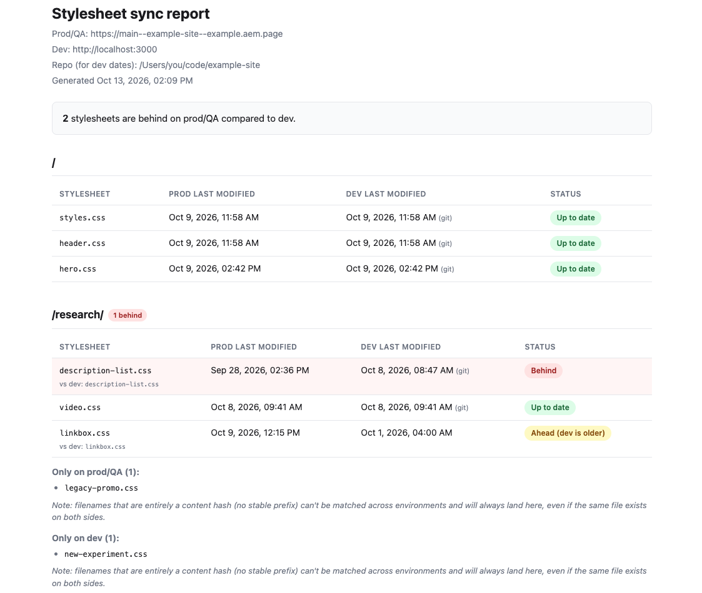

# Stylesheet sync checker

Finds CSS files that have gone stale on a QA/prod domain compared to dev —
i.e. a fix was merged and deployed to dev, but prod/QA never picked it up.

This came out of debugging a real case on an Edge Delivery Services (EDS)
site: a CSS fix was merged to `main` and visible on `localhost`, but the
`.page` preview kept serving a 10-day-old version of one block's CSS, with no
other sign anything was wrong. Comparing `Last-Modified` headers across
environments caught it in seconds. It works on any site, not just EDS —
including ones that serve bundled CSS with a content hash in the filename
(e.g. `main.a1b2c3d4.css`), which a simple path-for-path comparison would
miss.



## How it works

For each page path you give it:

1. Loads the page in headless Chromium (via Playwright) on **both** the
   prod/QA URL and the dev URL, and records every network response that was
   actually requested as a stylesheet — this catches static `<link>` tags
   *and* stylesheets injected later by client-side JS (e.g. EDS's
   lazy-loaded block CSS), which a plain HTML fetch would miss.
2. Matches prod and dev stylesheets to each other by filename **stem** —
   build-hash segments in the filename (`main.a1b2c3d4.css`) are stripped
   before matching, so the same logical file is paired up even when its hash
   differs between builds (`main.a1b2c3d4.css` ↔ `main.f00dcafe.css`).
3. For every matched pair, compares `Last-Modified`. Flags prod/QA as
   **behind** when it's older than dev, **ahead** if the reverse, or
   **differs** when a hash mismatch is the only signal and neither side
   exposes a usable date to confirm direction.
4. Also lists any stylesheet found only on one side (**prod only** / **dev
   only**) — useful for catching files that were added or removed entirely.

## Installation

```bash
git clone https://github.com/luisSilvaEs/stylesheet-sync-checker.git
cd stylesheet-sync-checker
npm install
npx playwright install chromium
```

(Node 18+ required.)

## Configuration

From inside the `stylesheet-sync-checker` folder you just cloned into, copy
the example config to create your own (gitignored, so it's yours to edit
freely — it won't be committed):

```bash
cp config.example.js config.js
```

That copies `config.example.js` as-is into `config.js`. Its contents are:

```js
export const prodUrl = 'https://main--your-site--your-org.aem.page';
export const devUrl = 'http://localhost:3000'; // optional, this is the default
export const pages = ['/', '/research/', '/playground/'];
export const repoPath = '/Users/you/code/your-site'; // see note below
```

Open `config.js` and replace those placeholder values with your own —
`prodUrl` for the QA/prod domain to check, `devUrl` only if it's not
`localhost:3000`, `pages` with the paths you want checked, and `repoPath`
with the local checkout behind your dev server (see below for why that
matters).

Or skip the config file and pass flags directly:

```bash
node scripts/run.js --prod https://main--your-site--your-org.aem.page \
  --dev http://localhost:3000 \
  --pages /,/research/,/playground/ \
  --repo /Users/you/code/your-site
```

CLI flags always override `config.js`.

### Why `--repo` / `repoPath` matters

When `devUrl` points at `localhost`, "dev last modified" normally comes from
the dev server's `Last-Modified` header — which on a local filesystem
reflects when the repo was last checked out or pulled, **not** when the
file's content actually last changed. That makes almost everything look
falsely "behind."

If you set `repoPath` to the local checkout behind that dev server, the tool
tries to resolve each stylesheet's URL path to a real file on disk under
`repoPath` and, when found, reads its true last-commit date from `git log`
instead. This works reliably for sites with stable, unhashed asset paths
(like EDS's `/blocks/<name>/<name>.css`) — the URL maps 1:1 onto a repo file.
For sites with hashed bundler output, the on-disk source file usually won't
exist at the served path, so this override silently doesn't apply there and
the tool falls back to whatever date the dev server reports.

If `devUrl` points at an already-deployed environment instead of localhost
(e.g. a feature-branch preview URL), `repoPath` isn't needed — its
`Last-Modified` header reflects the actual deploy.

## Run

```bash
npm run check
```

This checks every configured page, writes a timestamped report, and opens
`report.html` in your browser automatically. Pass `--no-open` to skip that.

Rebuild the HTML report from the most recent run's JSON without re-fetching
anything:

```bash
npm run report
```

## Output

Each run writes a folder:

```text
reports/2026-10-13T19-30-00-000Z/
  report.json
  report.html
```

`report.html` is grouped by page: a table of matched stylesheets with their
`Last-Modified` date on prod/QA vs dev and a status badge (**Up to date**,
**Behind**, **Ahead**, or **Differs**), plus any prod-only or dev-only files
listed separately.

`report.json` holds the same data in full, including every resolved
stylesheet URL on both environments.

## Known limitations

- Filename-hash stripping only recognizes hex-looking hash segments
  (`[a-f0-9]{6,40}`). Bundlers using a different hashing scheme for asset
  names may need a tweak to `scripts/lib/matchStylesheets.js`.
- When a hash differs and neither environment exposes a reliable
  `Last-Modified` (common for in-memory JS dev servers like webpack-dev-server
  or Vite), the tool can tell you the files differ but not which one is
  newer — reported as **Differs**.
- **Filenames that are *entirely* a hash, with no stable prefix** (e.g.
  Next.js/webpack `[contenthash].css` output like `1c0e6d4324e96672.css`)
  can't be matched at all — once the hash is stripped there's nothing left
  to pair on. These show up as prod-only/dev-only rather than matched, even
  if the same logical file exists on both sides. There's no reliable fix for
  this without risking false matches (e.g. guessing by position), so it's
  left as a gap rather than guessed at. Sites with at least a partial stable
  prefix (`main.<hash>.css`) are unaffected.
